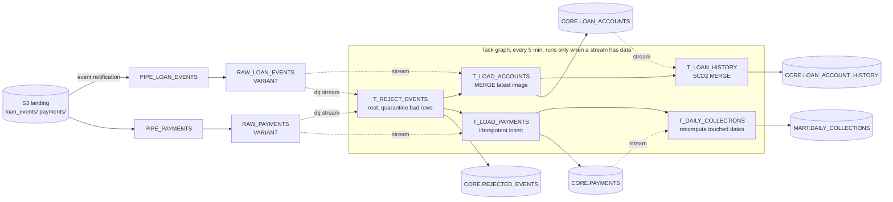

# Snowflake Incremental ELT: Snowpipe, Streams and Tasks

[](https://github.com/Kolli-Jahnavi-07/snowflake-incremental-elt/actions/workflows/ci.yml)

**Stack:** Snowflake (Snowpipe, Streams, Tasks, MERGE, VARIANT) · SQL · Python · AWS S3 · DuckDB · sqlglot · GitHub Actions

Continuous, incremental ELT for a loan-servicing feed. Files land in S3, **Snowpipe** loads them as they arrive, **Streams** capture exactly what changed, and a **Task graph** merges only those changes into current-state, history (SCD Type 2), fact and mart tables. Nothing is ever fully reloaded.

The whole pipeline is tested on every commit **without a Snowflake account**: a small emulator runs the same Snowflake SQL on DuckDB with Snowpipe load history, stream offsets and task-graph semantics, and an end-to-end test replays 45 days of a deliberately messy feed and checks every table, row by row, against an independent reference implementation.



## What it handles

The generator produces 90 days of activity for 2,250 auto loans (5,689 account events, 3,181 payments), with the problems a real upstream feed has:

| Problem in the feed | How the pipeline deals with it | Proven by |
|---|---|---|
| Same file delivered twice | Snowpipe load history skips it | `test_redelivered_file_loaded_once...` |
| Partial upload with a broken JSON line | `ON_ERROR = SKIP_FILE`; nothing half-loaded | same test |
| Events re-sent in a later batch | MERGE only applies an event newer than the stored one | `test_current_state_matches_reference` |
| Events arriving 1–4 batches late, out of order | Older events can't overwrite newer state | same test |
| Several changes to one loan in one batch | `QUALIFY ROW_NUMBER()` keeps the newest | same test |
| Payments re-sent | Insert-only MERGE on `payment_id` | `test_payments_are_deduplicated_and_complete` |
| Late payments for past dates | Mart recomputes only the dates that changed | `test_daily_collections_include_late_arriving_payments` |
| Missing keys, bad timestamps, negative balances, zero amounts | Skipped by the loads, quarantined with a reason by the root task | `test_invalid_rows_are_quarantined_not_lost` |
| A task fails mid-graph | Its stream offset doesn't move; descendants are cancelled; the next tick retries | `test_failures_mid_graph_recover_to_the_same_result` |

Result of a full local replay (`make demo`):

```
94 batches in 33 s
files:      loaded 280, load_failed 1
task runs:  succeeded 94, failed 0, skipped 1
  RAW.RAW_LOAN_EVENTS            5,689
  RAW.RAW_PAYMENTS               3,181
  CORE.LOAN_ACCOUNTS             2,250
  CORE.LOAN_ACCOUNT_HISTORY      5,476
  CORE.PAYMENTS                  3,098
  CORE.REJECTED_EVENTS              74
  MART.DAILY_COLLECTIONS            88
rejected:   non-positive amount (28), missing loan_id (18), invalid event_ts (16), negative balance (12)
```

## Design decisions

**One definition, two targets.** `snowflake/pipeline.yml` declares pipes, streams and the task graph. `python -m elt render` turns it into Snowflake DDL (`snowflake/generated/pipeline.sql`, checked in CI to be up to date), and the local emulator executes the same task SQL files. The SQL that's tested is the SQL that's deployed.

**One consumer per stream.** A stream's offset moves when any DML that reads it commits, so two tasks sharing a stream would each miss changes. Validation enforces one consumer per stream. Data quality gets its *own* streams on the raw tables, so quarantining rows never moves the load tasks' offsets.

**Retries without new data.** The root task's `WHEN SYSTEM$STREAM_HAS_DATA(...)` covers every stream any task consumes, not just the raw ones. If `T_LOAN_HISTORY` fails, its stream still has data, so the next 5-minute tick runs the graph again even if no files arrived. When every stream is empty the run is skipped and no compute is billed. Validation fails if a consumed stream is left out of the condition.

**SCD Type 2 in one MERGE.** Each changed loan enters the MERGE twice: keyed by `loan_id` to close the current version, and with a NULL key to insert the new one. Whether a loan changed is decided from the stream's own before/after images (`METADATA$ACTION = 'DELETE'` vs `'INSERT'`), not by joining the history table, so the statement never reads the table it's modifying. A row that only got a newer timestamp with identical attributes doesn't create a new version.

**Late facts, small recomputes.** `MART.DAILY_COLLECTIONS` is refreshed only for the `paid_date`s present in the payments stream, so a payment that shows up three weeks late corrects that one day instead of triggering a full rebuild.

**Serverless tasks and guardrails.** Tasks use serverless compute (`USER_TASK_MANAGED_INITIAL_WAREHOUSE_SIZE`), have a timeout, and the graph suspends itself after 3 consecutive failures. Roles are split (loader, transformer, reader), and a resource monitor caps monthly credits (`snowflake/setup/01_account.sql`).

## Repository layout

```
snowflake/
  setup/01_account.sql      roles, warehouse, database, resource monitor
  setup/02_ingest.sql       storage integration, S3 stage, file format, Snowpipes
  tables/                   raw (VARIANT + change tracking), core, mart DDL
  tasks/                    one SQL file per task body
  pipeline.yml              streams + task graph definition
  generated/pipeline.sql    rendered streams/tasks DDL (CI checks it's current)
  monitoring/health.sql     task history, pipe status, failed loads, stale streams, freshness
src/elt/
  pipeline.py               load + validate pipeline.yml, render DDL
  generator.py              synthetic, deliberately messy CDC feed
  local/dialect.py          Snowflake -> DuckDB SQL (sqlglot plus a few fixes)
  local/engine.py           emulator: Snowpipe load history, stream offsets, task graph runs
  __main__.py               generate | simulate | render | deploy
tests/                      32 tests: definition checks, dialect, emulator semantics, end-to-end
```

## Run it

```bash
pip install -r requirements.txt
make test                      # 32 tests, ~15 s
make demo                      # generate the feed and replay it batch by batch
PYTHONPATH=src python -m elt simulate -v   # per-batch task output
PYTHONPATH=src python -m elt render        # Snowflake DDL for streams + tasks
```

### Deploy to Snowflake

1. Run `snowflake/setup/01_account.sql` as an admin, fill in the bucket and IAM role in `02_ingest.sql`, then run `tables/raw.sql` and `02_ingest.sql` as `LOANS_LOADER`.
2. Point the bucket's `s3:ObjectCreated:*` notifications at the pipes' SQS channel (`SHOW PIPES`).
3. `pip install snowflake-connector-python`, set `SNOWFLAKE_ACCOUNT`, `SNOWFLAKE_USER` and `SNOWFLAKE_PRIVATE_KEY_FILE`, and run `PYTHONPATH=src python -m elt deploy` (or `--dry-run` to print the SQL). The `deploy` job in CI does the same on `main` once the repository variable `SNOWFLAKE_DEPLOY` is `true` and the secrets are set.

## About the local emulator

It models what this pipeline depends on: per-pipe load history, `SKIP_FILE`, stream offsets that advance only when the reading DML commits, `METADATA$ACTION` / `METADATA$ISUPDATE`, append-only vs standard streams, root `WHEN` conditions, and failed-task cancellation. It doesn't model time travel, stream staleness, concurrency, or Snowflake's internal row IDs (standard streams diff on a declared key locally). Those are covered by the monitoring queries in production.

## Author

**Sai Jahnavi Kolli**, Data Engineer · [saijahnavikolli.com](https://saijahnavikolli.com) · [LinkedIn](https://www.linkedin.com/in/kolli-sai-jahnavi) · [GitHub](https://github.com/Kolli-Jahnavi-07)
